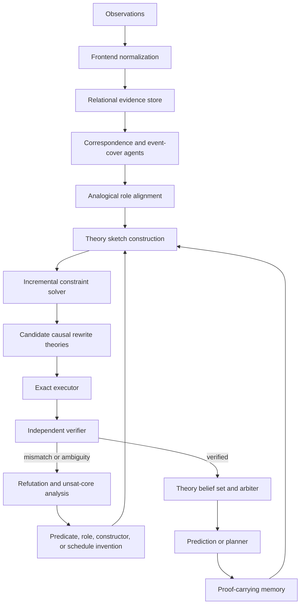

# CAIRN master design

**Causal Analogical Induction over Relational Networks**

Version: 1.0 architecture handoff

Status: implementable research design; no benchmark result is claimed by this document

Implemented checkpoint (2026-07-11): whole-theory procedural memory now records
independently verified reuse and requires it for promotion. The unchanged
cognition runtime replays learned map and selector theories through sequence,
vector, and finite-field frontends and searches two-procedure schedules without
a supplied composite. Finite-field reconstruction must exactly replay training
observations before the quarantined ARC adapter may consume a prediction.

Measured checkpoint (2026-07-12): composition is bounded at arbitrary depth,
independent reuse receipts consolidate into promotion certificates, typed
relational entity selectors transfer across adapters, and learned render
bindings cover changed geometry. A non-ARC partition-controller binding improved
the complete frozen ARC-1 training evaluation from 32/400 to 35/400 without a
lost solve. An offline AI-distilled selector learned across software, document,
and vector entities now rebinds unchanged to connected finite-field entities,
adding one causally ablated solve. The result is 36/400 (9.00%) with zero
incorrect tasks and does not satisfy the ARC or general-intelligence goals.

Later checkpoint (2026-07-12): the generated G6 composition is no longer
supplied as a completed proof host. A domain-neutral evidence frontier omits
learned operations and expected output. The runtime constructs bounded typed
candidates, learns a typed ordinal correspondence policy from one independently
verified construction, and emits one exact candidate for changed held-out
geometry and values. The expected graph remains verifier-only. This advances
experience-dependent construction but is not raw-observation theory induction.

Latest checkpoint (2026-07-12): exact structured observations now cross a
canonical relational envelope and independently replayed observation-to-proof
lowering. A value-free two-round relational fingerprint policy is bound to its
verified training construction. It transfers from a static vector-like case to
two action effects learned in an unknown interactive world despite changed
modality, IDs, values, order, cardinality, and a distractor. Ordinal transfer
fails; relational transfer yields one exact candidate. This remains structured
evidence learning, not raw sensor perception or broad general intelligence.

Active checkpoint (2026-07-12): the runtime now automates one-step latent-world
experiments. Exact induction exposes an unresolved successor; a generic
environment boundary returns only the visible outcome of the selected
distinguishing action. Continuity and bounds are checked before re-induction.
The frozen case recovers two hidden states and six rules with one intervention
versus three uninformed actions, predicts 150/150 held-out transitions, plans
two actions to an inferred goal, and transfers learned mode-conditioned rules
through the relational constructor. Longer experiments and noisy belief remain
open.

Persistent-world checkpoint (2026-07-13): complete hidden-state theories now
compile to canonical mechanisms that exclude action IDs, coordinate bounds,
source traces, support counts, and latent-label permutations. A separately
implemented verifier reconstructs compilation and current replay. Memory alone
promotes after two distinct verified worlds. On a third world with renamed
actions and changed bounds/positions, runtime rebinding preserves 510/510 exact
predictions while reducing interventions from one to zero. This establishes a
small experience-dependent reduction; it does not establish broad unknown-world
competence, open-ended learning, or general intelligence.

Developmental-world checkpoint (2026-07-13): the unchanged source-independent
schema now covers a frozen curriculum of five structural signatures: one to
four latent states, two to four action roles, one/two visible dimensions, and
different transition graphs. A content-free frontier curriculum selects their
order. Across five held-out worlds, persistent binding reduces visible evidence
from 42 transitions to 10 and retains exact rules with no wrong schema accepted.
Canonical CAS commitments reload as untrusted data and regain promotion only
after independent compilation and transfer replay. A separate sequential
version space synthesizes the shortest two-action diagnostic when every
one-action observation is identical. The same learned interactive mechanism
then predicts sequence and vector transitions through adapter-only lowering.

Quarantined evaluation checkpoint (2026-07-13): after committing the general
core, the frozen structural ARC first-40 remains 18 exact/zero incorrect and the
complete ARC-1 training corpus remains 36/400 exact, zero incorrect, 364
resource-limited. The flat result is informative: finite action/state mechanism
memory does not yet supply the relational entity correspondences, constructors,
and render bindings needed by most unsolved static tasks. No core change is
derived from this evaluation.

## 0. Executive decision

CAIRN is a CPU-only, transformer-free self-compressing causal theory learner.
Its central persistent object is a verified **Mechanism**: a parameterized,
executable causal rewrite theory with explicit support geometry and derivation.
Its principal output is an expanding tested language of mechanisms, not an
answer, action sequence, fixed ARC program, or vector prediction.

For a static induction problem, the system must explain demonstrations with a compact set of quantified graph-rewrite rules. It discovers the rules by aligning observed events, solving unknown predicates and constructors, executing the resulting theory, and using exact mismatches as counterexamples. Perception is induced jointly with the theory: an entity, motif, region, symbol, or track exists in the working model only because its definition helps explain observations. ARC grid pairs are one adapter representation of this generic problem.

For an interactive task, the same theory language models state transitions, observations, action effects, hidden variables, and goals. The system maintains a posterior over possible world theories, chooses interventions by expected information gain plus goal value, and plans through the surviving theories.

The core design is summarized by three nested loops:

```text
online: observe -> maintain competing theories -> test/refute -> predict or plan
consolidation: compare proof graphs -> anti-unify -> invent -> verify -> promote
curriculum: locate weak support -> seek informative experience -> test composition
```

The online learner does not decide what becomes permanent. A separate
consolidator proposes reusable mechanisms; an independent verifier gates replay;
and a curriculum runtime chooses experiences. See ADR-0007.

The implemented consolidation contract uses typed immutable proof DAGs. It
normalizes the ancestral subgraph of a selected result, groups episodes by
operation/type/dependency shape without benchmark family labels, anti-unifies
only typed argument values, and exactly reconstructs every source subgraph
before emitting an opaque compression proposal. The memory promotion runner
requires that proposal's source identities to equal the independently invented
definition lineage. The cohort is compiled into a fresh alpha-normalized RKL
definition with generalized observed type bounds, while a separately
implemented verifier reconstructs source graphs and recalculates compression
costs before issuing the token required by memory. The bounded internal miner
also compiles contiguous typed proof fragments into canonical executable
schemas whose identities exclude evidence episodes and costs. Independent
runtime receipts measure fresh-window, example, and proof work; the second
qualifying experience automatically asks a separate consolidator for the only
certificate that may promote the schema. Canonical proof sources and internal
reuse commitments now survive CAS restart; authority returns only after
remining, recompilation, independent replay, and a newly issued certificate.
Arbitrary graph-edit anti-unification, RKL lowering for operations with explicit
semantics, and optimized compiled-module snapshots remain open.

The developmental controller is now stateful rather than a benchmark-scripted
loop. It selects eligible support gaps by information, transfer, underuse, cost,
and risk; learned prerequisites unlock composition objectives; verified
counterexamples quarantine and deprecate mechanisms. A frozen non-ARC run grows
four distinct mechanisms across two CAS restarts with repeated memory-off
reductions, complete retention, and zero unrelated transfer. The finite
objective set remains generator-authored, so this is bounded autonomy rather
than open-ended self-generated experience.

The controller no longer survives those restarts through process memory. A
canonical content-free journal persists objective definitions, accepted
learning summaries, counterexamples, and outstanding work. Restore creates a
fresh controller and deterministically replays its public methods; learned
support, quarantine, deprecation, and prerequisite eligibility are derived
again rather than trusted from serialized flags. Changed decisions or malformed
lineage fail closed.

The controller may now expand its own objective frontier from a redacted
failed-search core. Structural type/count/determinism evidence selects a
developmental need and canonical objective identity; learned mechanism roles
can become composition prerequisites. Each addition is replayed at its original
event boundary. The generator proposes what capability should be exercised; it
does not yet synthesize the environment that exercises it.

At the proof-mechanism layer, a separate materializer now consumes that request
and emits canonical `RelationalObservation` values. The cognition runtime lowers
opaque typed elements and finite relations without modality checks, searches
bounded mechanism combinations on a training frontier, and induces structural
correspondence. A verifier independently reconstructs observation lowering and
policy induction, binds the policy to the exact training receipt, and alone
receives held-out proof. The same policy then consumes action effects learned by
the interactive world learner. Verified completion returns to the curriculum
journal. Raw sensor-to-relational-evidence induction remains the next boundary.

The architecture deliberately avoids two failed patterns:

```text
SCEM: learn reusable surface programs from previously solved traces
MOSAIC: enumerate a fixed high-level DSL over precomputed parse worlds
```

CAIRN instead uses a small universal relational kernel and induces high-level semantics as task-local, proof-carrying definitions.

The finite-observation frontend now includes a learned remapping constructor.
It synthesizes output extents and coordinate-conditioned source sampling as RKL
definitions, using complete replay to resolve a bounded affine correspondence
version space. Modal-complement content bounds are candidate entity evidence,
not accepted semantics by appearance alone. This supports general transpose and
content-relative extraction, but not creation of novel values, non-affine
layouts, multi-entity selection, or recursive construction.

The same frontend now proposes connected entity frames and learns their role by
contrast over generic geometry/content features; no fixed selector such as
smallest, largest, or square is supplied. A local causal learner separately
induces cell transitions from bounded neighborhood observations. Proposal
routing uses only demonstrated output support, allowing learned local laws to
improve capability without unconditionally doubling search.

Long-range observation summaries—nearest visible value along each axis and
axis occupancy—are computed lazily only after basic local evidence is
insufficient. They remain observation features rather than named operations;
the learned RKL definition decides whether and how they matter. Repeated
full-corpus timing shows synthesis, not perception, is now the dominant cost,
motivating learned grammar priors and proof-fragment retrieval.

The local-law frontend now exposes its typed `InventionProblem` instead of
owning a private fresh-search-only path. This lets the common cognition runtime
offer persistent mechanisms while the frontend only wraps independently
admitted outcomes. The first integration experiment exposed factorial eager
parameter rebinding in memory retrieval. Retrieval now tries a name-preserving
binding first and bounds both direct and composed rebindings with a
1,024-proposal hard ceiling. A verified local law then
reduced a frozen solve from four fresh candidates and 21 examples to one
replayed proposal and three examples, while transferring exactly over 35
changed cells. Memory still cannot bypass current-demonstration replay.

### 0.1 General-learning claim boundary

CAIRN is not considered a general learner merely because it can represent or
search for programs. General learning requires measured evidence from three
co-developed loops:

```text
task learning: infer a previously unstored theory
continual learning: verified experience improves later learning
interactive causal learning: learn unknown dynamics, goals, and skills online
```

ARC is one quarantined adapter and benchmark. It may exercise exact induction,
but it does not define core APIs, development order, or the general-learning
claim. The six mandatory gates are specified in
`08_GENERAL_LEARNER_REQUIREMENTS.md`.

### 0.2 Developer substrate and learner invention

Developers provide bounded computation—types, sets, relations, variables,
arithmetic, graphs, observations, time, actions, conditionals, bounded
iteration/recursion, and composition. Objects, containers, paths, symmetries,
selectors, constructors, transition laws, symbol semantics, and conditional
skills count as invented only when synthesized from that substrate and shown to
compress independent theories, predict held-out situations, rebind, and reduce
future learning cost under ablation.

### 0.3 Technical-chatbot, distillation, and shared-knowledge boundary

The initial product target is a verified software-engineering chatbot, not an
unrestricted prose model. Six logical runtimes surround cognition:

```text
cairn-language -> semantic intent graphs
cairn-dialogue -> multi-turn goals, references, preferences, artifacts
cairn-cognition -> theories, plans, mechanisms, and skills
cairn-knowledge -> sourced facts, documentation, episodes, contradictions
cairn-tools -> sandboxed typed tool and code execution
cairn-realiser -> controlled answer plans and readable responses
```

Language compilation never solves the task. Code generation proceeds through a
contract and typed AST, executable examples, resource checks, and independent
verification before source rendering. The initial controlled realizer may sound
less fluid than a neural chatbot; correctness, provenance, and continual
learning take precedence over unrestricted prose breadth.

External teachers transfer no weights or hidden representations. A dedicated
offline distillation spool serializes schema-constrained requests containing
intent annotations, typed claims, procedures, candidate mechanisms,
implementations, tests, counterexamples, variation axes, and uncertainties.
Raw packets retain origin provenance and are untrusted. The compiler decomposes
them into CAIRN-native artifacts; validators replay executable claims; the
consolidator anti-unifies multiple successful examples; falsifiers challenge
support boundaries; and only transfer-tested artifacts may reach shared memory.

```text
teacher -> packet -> compile -> verify -> consolidate -> peer/transfer test
        -> shared memory -> autonomous CPU runtime -> new evidence
```

Two wire adapters are supported: a GPT-compatible structured Responses envelope
and an Anthropic-compatible forced-tool Messages envelope. They only export
request bytes and import saved response bytes. The code has no network,
credential, provider SDK, or process-execution capability. External transport
is deliberately outside CAIRN. During chat, ARC, and all other inference,
CAIRN answers from current evidence plus accepted local/swarm knowledge only.

Distillation channels remain separate: language, declarative knowledge,
procedures, mechanisms, skills, curricula, and counterexamples have different
validators. Teacher confidence is never verification. Raw chain-of-thought,
benchmark answer sets, opaque prose rules, and verbatim response memorisation
are prohibited ingestion targets.

Swarm transfer is by immutable content-addressed value. Every artifact carries
author, parents, semantics version, origin, evidence, support geometry,
applicability, known failures, resource profile, trust lifecycle, and revocation
state. Authors cannot act as their own peer verifier; voting never substitutes
for replay. Agents pull relevant knowledge by typed need and may push only
critical revocations, security corrections, and high-value metadata.

The first complete distilled-memory audit validates the correctness boundary
but falsifies unconditional retrieval as an efficient policy. A single clean
spatial mechanism is reused on one of 400 ARC tasks, reducing that local search
from two candidates to one with zero incorrect acceptance, while the complete
memory-on run is roughly 38 seconds slower. Retrieval must therefore be gated by
typed unresolved cores or contextual evidence before shared libraries grow;
proof-safe rejection alone is insufficient for CPU efficiency.

Memory semantics 1.1.0 implements the first contextual correction. Rebound
single-variable mechanisms are compared with current demonstration bindings and
discarded before compilation if any observation contradicts them. This is a
sound refutation, not heuristic acceptance: surviving proposals still receive
complete dual-executor replay, and fresh search remains reachable. The full
contextual audit recovers the measured overhead (390.85 seconds, 32/400, zero
incorrect) while preserving actual reuse.

The first larger offline teacher curriculum induced 20 provisional mechanisms
from 40 non-ARC spatial-sensor lessons. On the same frozen 400-task ARC run it
scored 32 exact, 368 resource-limited, and zero incorrect in 476.50 seconds;
none of the new mechanisms entered a selected proof. The infrastructure and
trust boundary passed, but the transfer hypothesis failed. Future curricula
must target generic unresolved failure cores and demonstrate proof-trace use,
not merely add plausible spatial formulas.

Failure-core semantics 1.0.0 now provides that feedback loop. It reduces any
failed `InventionProblem` to content-free type/arity, variation, output-class,
determinism, anonymous mechanism-family, and resource-bound evidence. It cannot
retain task IDs, variable names, observations, literals, grids, or answers. The
same core feeds both offline teacher envelopes.

The first frozen sample produced nine distinct cores. One contained conflicting
outputs for identical 13-feature observations, proving that search could not
solve it. The generic field frontend now checks observational determinism and
escalates from basic to long-range relational evidence before synthesis. The
conflicting core disappears, and a non-ARC row-occupancy family transfers over
changed geometry and values. The remaining eight cores are deterministic but
match none of the tested one-, two-, or three-role scalar families. ARC remains
17/40 at 1,000 candidates, so this is a successful self-diagnosis and
representation correction, not a benchmark-score gain.

Distillation semantics 1.2.0 adds the first non-scalar teaching channel. A
collection lesson contains aligned input/output episodes with varied bounded
cardinality. The teacher does not provide a `ForEach` program. CAIRN invents the
element definition using RKL, constructs a checked variable-arity rewrite
theory, and replays every source element. An offline GPT-authored non-benchmark
lesson over cardinalities 2, 4, and 5 transfers exactly to cardinality 7 after
two independent peer recompilations. Fixed-cardinality-only packets and
duplicate values under the current set semantics are rejected. This establishes
bounded collection distillation, not arbitrary hierarchy or ARC transfer.

Memory semantics 1.2.0 closes the first proposal-use loop for whole theories.
Verified teacher collection theories enter procedural memory as provisional,
with source episode proofs and replay counts but zero claimed reuse. The common
cognition runtime accepts a collection problem, executes each reusable theory
against every current demonstration, rejects contradictions, deduplicates
semantically identical predictions, and returns at most the requested bound.
A sequence/set adapter reuses the offline theory after two changed
demonstrations and predicts an unseen cardinality 8 in one proposal. Blank
memory fails and a competing `output := input + 1` family refutes the proposal.
This is actual non-ARC downstream reuse; persistence and ARC entity binding
remain open.

## 1. Requirements

### 1.1 Hard constraints

- CPU only for training, inference, evaluation, and swarm execution.
- No transformer architecture or transformer dependency.
- No GPU runtime, GPU kernel, GPU library, remote GPU service, or GPU-generated answer path.
- Deterministic replay for all exact-domain claims.
- Commodity baseline: 8 physical CPU cores, 16 GB RAM.
- Static-task solver is anytime and must return at most two semantically distinct attempts.
- Interactive solver maintains bounded compressed state rather than raw unbounded frame history.
- All persisted learned mechanisms are proposal sources only; correctness is established by current-task evidence and an independent verifier.
- Evaluation tasks never enter training, debugging, prompt construction, primitive design, or search-policy tuning.

### 1.2 Capability requirements

The static solver must natively express and induce:

- identity and global geometric transforms;
- recoloring by literal, role, relation, or symbol;
- object selection by relational context;
- variable-arity mapping over entities;
- creation, deletion, movement, copying, merging, splitting, and replacement;
- crop, padding, scaling, tiling, panel extraction, and canvas construction;
- multicolor shape construction;
- rules that interact through dependency ordering;
- parallel, sequential, conditional, recursive, and bounded-fixpoint behavior;
- symbolic control, legends, keys, and operator-valued symbols;
- output dimensions and coordinates derived from input structure;
- ambiguity management and pass@2 diversity.

The interactive solver must add:

- action-conditioned transition induction;
- hidden-state and partial-observation handling;
- online goal inference;
- active experimentation;
- long-horizon planning;
- option or skill induction with learned termination conditions;
- memory compression and retrieval.

The continual learner must add:

- proof-backed mechanism promotion and deprecation;
- explicit support geometry and unsupported-axis uncertainty;
- fixed-budget memory-on versus memory-off improvement;
- skill and mechanism composition without coded composite operators;
- negative-memory reuse without making valid candidates unreachable;
- knowledge claims with source, time, contradictions, and provenance.

The same cognition runtime must operate on finite-field transformations,
interactive worlds, and vector graphics or diagrams before a general-learning
claim is permitted.

### 1.3 Performance requirements

Engineering targets, to be validated rather than assumed:

- grid kernel throughput: at least 20 million primitive cell or bitset operations per core per second;
- static perception and evidence construction median: below 50 ms per task;
- first valid theory median: below 2 s on ARC-AGI-1 training after optimization;
- full static solve median: below 8 s, p95 below 60 s, hard cap 120 s on the baseline machine;
- common interactive state update: below 100 ms;
- ordinary interactive action choice: below 500 ms, with explicit longer deliberation only when action timing permits;
- memory below 2 GB per static task and below 4 GB per interactive episode on the baseline machine;
- local 8-worker speedup target: at least 4.5 times over one worker on the theory-search portion.

These are gates in the experiment plan, not reported achievements.

## 2. Research position and architectural choice

### 2.1 What current ARC suites require

ARC-AGI-2 explicitly emphasizes symbolic interpretation, compositional reasoning, and contextual rule application. A solver therefore needs more than geometric operator enumeration. It must bind visual symbols to semantics, infer multiple interacting rules, and condition behavior on relationships rather than surface appearance.

ARC-AGI-3 changes the task from static induction to online skill acquisition. It requires exploration, goal inference, world-model construction, planning, and efficient use of interaction history. A static puzzle harness with game-specific procedures is not an acceptable general solution.

### 2.2 Useful prior techniques

CAIRN adopts ideas, not architectures, from several established lines of work:

- object-centric graph abstraction and constraint acquisition;
- generalized planning with induced programs;
- relational analogy and systematic structure mapping;
- anti-unification for extracting shared relational form;
- counterexample-guided inductive synthesis;
- learning from failures, where failed hypotheses generate pruning constraints;
- equality saturation for compactly maintaining equivalent expressions;
- active causal learning with expected information gain.

Each technique addresses one layer. None alone resolves the complete problem. CAIRN combines them around a different central object: a jointly induced perceptual and causal rewrite theory.

### 2.3 Rejected alternatives

#### Larger fixed ARC DSL

Rejected because MOSAIC's measured frontier was inexpressible, not compute-limited. Expanding a catalog of operations creates another closure boundary and encourages task-shaped patches.

#### Pure brute-force universal program search

Rejected because a universal language without evidence-derived sketches is computationally unusable. Universality is needed for closure; blind enumeration is not the search algorithm.

#### Stored macro or concept library as the main intelligence

Rejected because SCEM measured near-zero evaluation transfer from three learned artifact classes. Stored mechanisms remain useful only as hypotheses that must be rebound and verified.

#### End-to-end non-transformer neural prediction

Rejected as the primary path because it would still need large training distributions, would not naturally produce exact causal certificates, and would make CPU-only test-time adaptation expensive. Small non-transformer statistical models are permitted for noisy frontends or search ordering, never as the sole static-task reasoner.

#### Evolutionary program search

Rejected as the core because it spends large budgets rediscovering local syntax, has weak failure-derived pruning, and makes exact attribution difficult. Evolutionary search may be used as a bounded secondary proposer for derived features.

## 3. Core hypothesis

CAIRN's central hypothesis is:

> Few-shot abstract tasks become tractable when inference begins with the observed causal event structure and searches only for theories that can account for those events, while allowing the system to invent task-local relational definitions inside a universal executable kernel.

This decomposes into six testable claims.

### H1: Event correspondence is a stronger search prior than program syntax

The input-output difference constrains which entities were preserved, transformed, consumed, or created. Constructing a small set of plausible event covers should reduce search more than forward enumeration by program size.

### H2: Perception should be justified by explanation

An entity definition that makes a transformation simple is preferable to a segmentation selected without reference to the output. Joint abduction should recover useful multicolor objects, panels, motifs, and roles that a fixed parse lattice misses.

### H3: A theory of multiple quantified rules is the correct unit of composition

Many tasks are not one program chain. They are a set of context-dependent rules with explicit dependencies, concurrency, and rendering conflicts. Inducing the dependency graph should handle composition more naturally than increasing term depth.

### H4: Dynamic derived definitions can remove the fixed-DSL ceiling

The kernel remains fixed and universal, but the search vocabulary can expand during a task. New predicates, entity definitions, operator-valued symbol maps, constructors, and recursive abbreviations are accepted only when they have executable kernel definitions and improve exact explanatory compression.

### H5: Counterexamples should change both search constraints and ontology

A failed candidate is not merely discarded. Its mismatch cells, failed bindings, and unsatisfied explanation core generate constraints. Repeated failures that cannot be separated by existing features trigger invention of a new relation or role.

### H6: The same theory representation can support static induction and interactive intelligence

A static input-output transformation is a one-step transition. An interactive world is a sequence of such transitions conditioned on actions. The same rewrite theory, belief manager, and planner should therefore extend to ARC-AGI-3 and other modalities.

## 4. System overview



### 4.1 Major subsystems

1. **Frontend normalization** converts grids, frames, audio events, vector graphics, text facts, or environment records into observations with explicit coordinates, channels, and uncertainty.
2. **Relational evidence store** lazily materializes cells, sets, entities, motifs, relations, and temporal events.
3. **Event-cover engine** builds alternative causal explanations for each observed transition.
4. **Analogical aligner** maps roles and relations across demonstrations while ignoring irrelevant appearance differences.
5. **Theory weaver** anti-unifies aligned events into rule sketches with typed holes.
6. **Constraint synthesizer** jointly solves selectors, constructors, symbol meanings, dependencies, and output rendering.
7. **Executor and verifier** produce exact outputs and proof certificates.
8. **Refuter and inventor** learn constraints from failure and create new task-local definitions when the current ontology is inadequate.
9. **Belief manager and arbiter** preserve distinct explanatory modes and choose two diverse attempts.
10. **Temporal model and planner** extend the theory to action-conditioned sequences.
11. **Memory system** stores proof-backed mechanisms, counterexamples, and compiled definitions.
12. **Swarm runtime** coordinates heterogeneous agents through immutable artifacts.

### 4.2 No privileged monolithic controller

The coordinator schedules jobs and maintains budgets. It does not contain domain logic. Every substantive proposal is an artifact that can be inspected, replayed, refuted, and reproduced by another process.

## 5. Foundational representation

### 5.1 Observation

An observation is a finite typed field plus metadata:

```rust
pub struct Observation {
    pub id: ObservationId,
    pub modality: Modality,
    pub axes: Vec<AxisSpec>,
    pub channels: Vec<ChannelSpec>,
    pub values: ValueStore,
    pub uncertainty: Option<UncertaintyStore>,
    pub timestamp: Option<LogicalTime>,
}
```

For ARC-AGI-1/2, `values` is a 2D color grid. For ARC-AGI-3, it is a frame plus action and episode metadata. Frontends may attach uncertain detections, but the raw observation always remains available.

### 5.2 Relational Evidence Graph

The **Relational Evidence Graph**, abbreviated REG, is a typed attributed hypergraph.

Nodes can represent:

- cells;
- coordinates;
- colors or channel values;
- cell sets;
- candidate entities;
- boundaries, contours, holes, axes, and regions;
- panels, motifs, repetitions, and symbol tokens;
- actions, states, observations, rewards, and temporal events;
- latent roles and derived definitions.

Hyperedges represent typed relations such as:

- membership;
- adjacency and connectivity;
- containment and overlap;
- relative direction and displacement;
- alignment, symmetry, congruence, and similarity;
- count, rank, and uniqueness;
- source-to-target correspondence;
- causal production;
- temporal precedence and action conditioning.

```rust
pub struct RelGraph {
    pub nodes: NodeArena,
    pub edges: EdgeArena,
    pub indexes: RelationIndexes,
    pub derivations: DerivationArena,
}

pub struct HyperEdge {
    pub relation: RelationId,
    pub args: SmallVec<[NodeId; 4]>,
    pub attrs: AttrMap,
    pub confidence: EvidenceWeight,
    pub derivation: DerivationId,
}
```

The implementation is structure-of-arrays and index-driven. It is not a general database. Common relations have specialized bitset indexes.

### 5.3 Entity algebra

CAIRN does not enumerate complete parse worlds. It defines entities lazily through an **entity algebra**.

Representative constructors:

```text
CellsWhere(predicate)
Connected(seed_or_mask, connectivity)
ColorComponent(color_role, connectivity)
MulticolorComponent(boundary_rule, connectivity)
Run(axis, predicate)
Contour(entity)
Holes(entity)
BoundingBox(entity)
RectangleFrom(corners_or_extent)
SymmetryOrbit(entity, group)
RepeatGroup(seed, displacement_relation)
Panel(region_or_separator_rule)
Motif(equivalence_relation)
DifferenceRegion(before, after)
Track(entity_across_time)
```

An entity expression has a cost, a denotation, and a derivation. Equivalent denotations are merged in a typed e-graph. Entity definitions are requested by theory holes and event explanations rather than generated as a Cartesian product of segmentation settings.

### 5.4 Roles

A role is a variable whose meaning is relational, not a fixed label.

Examples:

```text
source_object
selected_object
reference_object
anchor
marker
payload
delimiter
legend_key
legend_value
control_symbol
target_region
obstacle
goal
agent
```

A role hypothesis is defined by a clause over entities and relations. The same role can be bound to different colors, shapes, sizes, or positions in different demonstrations.

### 5.5 Provenance is mandatory

Every derived entity, event, output cell, learned definition, and memory item carries a derivation DAG. Provenance distinguishes:

- observed fact;
- deterministic derived fact;
- hypothesis;
- selected model choice;
- external or uncertain frontend evidence;
- persisted prior.

No output cell may be marked verified without a chain from current observations through executable theory steps.

## 6. Relational Kernel Language

### 6.1 Purpose

The **Relational Kernel Language**, RKL, is the fixed computational substrate. It is intentionally lower-level and more general than an ARC DSL. It supplies finite sets, relations, bounded arithmetic, coordinate geometry, graph matching, rendering, conditionals, and bounded iteration.

High-level operations such as “copy each enclosed object to its matching panel” are not kernel primitives. They are induced definitions over RKL.

### 6.2 Type system

```text
Bool
Int[lo, hi]
Atom
Coord2
Vector2
Axis
Transform2
CellSet
Shape
Entity
EntitySet
Symbol
Action
State
FiniteField<axes, max-elements>
Relation<A...>
Option<T>
List<T, max>
Map<K, V, max>
Operator<A, B>
```

Ranges and collection bounds are explicit. Finite-field axis meanings and atom
interpretations belong to adapters, not RKL. Static programs are total under
observation-derived bounds. Interactive programs consume a fuel budget and
expose any nontermination as verification failure.

### 6.3 Expression forms

```text
Literal
Variable
Tuple
Let
If
Match
Call
RelationQuery
SetComprehension
Map
Filter
Fold
Count
Any
All
Unique
ArgMin
ArgMax
Rank
GroupBy
Join
TransitiveClosure with bound
BoundedFixpoint
```

Geometry and rendering are expressed through verified intrinsics that are themselves specified against reference semantics:

```text
translate
apply_affine_d4
scale_integer
crop
pad
rasterize
outline
fill
line_segment
ray
bbox
centroid_exact_or_rational
project_to_axis
```

### 6.4 Theory structure

A theory contains definitions, rules, a schedule, and a renderer.

```rust
pub struct Theory {
    pub inputs: Vec<Binder>,
    pub definitions: Vec<Definition>,
    pub rules: Vec<RewriteRule>,
    pub schedule: Schedule,
    pub renderer: Renderer,
    pub assumptions: Vec<Assumption>,
    pub score: TheoryScore,
}

pub struct RewriteRule {
    pub binders: Vec<Binder>,
    pub guard: PredicateExpr,
    pub effects: Vec<Effect>,
    pub priority: PriorityExpr,
}
```

Theory inputs are typed generic observation/request bindings. They are in scope
for rule domains and guards, renderer expressions, and assumptions. Adapter
types never enter this declaration.

Rule binders support one entity, tuples, groups, variable-arity sets, and operator-valued symbols.

Effects include:

```text
Preserve
Delete
UpdateAttribute
Move
Copy
Transform
Split
Merge
EmitShape
Emit
Paint
Erase
CreateRelation
SetLatentState
Write
EmitRewardHypothesis
```

All convenience effects lower to a small cell/entity mutation calculus before execution.

### 6.5 Schedule semantics

```rust
pub enum Schedule {
    Parallel,
    Sequence(Vec<RuleId>),
    DependencyDag(DependencyDag),
    DecisionList(Vec<RuleId>),
    BoundedFixpoint { rules: Vec<RuleId>, max_steps: BoundExpr },
    Hierarchical(Vec<Schedule>),
}
```

The schedule is inferred. It is not assumed that all rules run once or that a task is a fixed-depth chain.

### 6.6 Renderer

The renderer makes canvas construction explicit:

```rust
pub struct Renderer {
    pub canvas: CanvasExpr,
    pub layers: Vec<LayerExpr>,
    pub conflict_policy: ConflictPolicy,
    pub background: Expr,
}
```

Canvas expressions may derive dimensions from input, selected panels, entity extents, counts, repetition periods, or rule outputs. Every output write records its source and layer. Conflicting writes are either ruled out by constraints or resolved by an explicit inferred policy.

### 6.7 Expressive closure

RKL is designed to express any bounded finite observation transformation by
quantifying over finite domains and emitting values, entities, relations, or
state effects. Spatial adapters may lower a field to coordinates and elements,
but those axes are not RKL semantics. Literal member-by-member solutions carry
prohibitive description cost and cannot generalize; they exist only to establish
substrate completeness and diagnose search failures.

The practical search language is the set of low-cost definitions and theory sketches induced from evidence. Dynamic invention changes that language without adding opaque, unverifiable semantics.

## 7. Demonstration inference: evidence to event covers

### 7.1 Transition framing

Each demonstration is treated as one observed transition:

```text
context O_i  --unknown mechanism/intervention-->  outcome O'_i
```

The first inference problem is not “which program generated H_i?” It is:

> which minimal set of causal events could account for every preserved, changed, deleted, and created entity, relation, or value in the outcome relative to its context?

### 7.2 Candidate entity demand

The event engine asks the entity algebra for candidate source and target entities only when they can participate in a low-cost explanation. Demand sources include:

- unchanged relation-defined groups;
- maximal mismatch evidence;
- repeated structures;
- candidate containers;
- entities whose categorical, structural, or topological evidence matches across context and outcome;
- entities related by low-complexity transforms supplied as evidence;
- symbols whose variation correlates with an effect;
- unmatched output regions requiring construction.

This keeps perception coupled to explanatory need.

### 7.3 Correspondence hyperedges

A correspondence can map zero, one, or many source entities to zero, one, or many target entities.

```rust
pub enum EventKind {
    Preserve,
    Update,
    Move,
    Transform,
    Recolor,
    Copy,
    Delete,
    Create,
    Split,
    Merge,
    Aggregate,
    Distribute,
    RenderPanel,
    InterpretSymbol,
}

pub struct EventHypothesis {
    pub kind: EventKind,
    pub sources: SmallVec<[EntityId; 4]>,
    pub targets: SmallVec<[EntityId; 4]>,
    pub parameter_sketch: ExprSketch,
    pub required_relations: Vec<RelationLiteral>,
    pub covered_input_cells: CellSetId,
    pub covered_output_cells: CellSetId,
    pub cost: Cost,
    pub provenance: DerivationId,
}
```

Events may overlap only when the renderer permits layered writes. Candidate generation uses invariant signatures and bounded matching:

- exact shape and color signature;
- shape under D4 transform;
- scaled or tiled signatures;
- color-normalized shape;
- topology and contour signatures;
- relative-coordinate signatures;
- multiset signatures for groups;
- geometric construction signatures for lines, rectangles, fills, and repetition.

### 7.4 Event-cover optimization

For each pair, choose a set of events that explains the transition.

Hard constraints:

- every output cell is produced exactly once unless an explicit layer relation permits multiple writes;
- every changed input cell is consumed, updated, hidden by a justified layer, or declared irrelevant by canvas selection;
- event parameters are internally consistent;
- source and target membership constraints hold;
- the rendered result equals the output exactly.

Objective, lexicographically:

1. exact coverage;
2. minimum unexplained structure;
3. minimum event description length;
4. maximum reuse of the same event form;
5. minimum literal constants;
6. minimum entity-definition cost.

The engine keeps the top `K_cover` structurally distinct covers, not only the cheapest cover. Structural distinction is based on event-kind multiset, source-target arity, and causal dependency shape.

### 7.5 Pair-local counterexamples

When no exact cover exists, the solver emits a typed explanation core rather than `inexpressible` alone:

```text
unmatched_target_region
source_correspondence_missing
constructor_missing
entity_definition_missing
color_function_missing
coordinate_expression_missing
layer_conflict
variable_arity_required
merge_or_split_required
symbol_semantics_required
schedule_required
```

The core is the input to ontology expansion in Section 11.

## 8. Cross-example analogical alignment

### 8.1 Why correspondence must precede rule search

Demonstrations normally instantiate the same abstract rule with different colors, counts, sizes, and positions. A syntactic program search repeatedly rediscovers those bindings. CAIRN first maps the relational roles across examples.

### 8.2 Structural signatures

Each event participant receives a signature containing:

- intrinsic attributes: area, shape, colors, topology;
- relational neighborhood: containment, alignment, adjacency, rank, uniqueness;
- causal role in the pair cover;
- relations to unchanged context;
- relations to control symbols or panels;
- source-target transform parameters expressed relative to other entities.

Appearance features are marked as either potentially semantic or potentially incidental. No color is automatically treated as a label or as a literal.

### 8.3 Structure mapping

The analogical aligner builds candidate maps between pair event graphs under these preferences:

1. preserve relation structure;
2. preserve causal role;
3. prefer one-to-one mappings unless the event arity requires a group;
4. prefer systematic connected mappings over isolated feature matches;
5. allow intrinsic attributes to differ when a common relational role explains them;
6. reject mappings that force incompatible event semantics.

The implementation uses a beam search over consistent partial mappings with upper bounds from unmatched relation weight. Small subgraphs may use exact maximum common subgraph or VF2-style matching.

### 8.4 Anti-unification

Aligned event instances are generalized into a `RuleSketch`.

Example concrete instances:

```text
pair 1: copy blue 2x2 object right of red marker to the marker's left side
pair 2: copy green L-shape below yellow marker to the marker's upper side
```

Possible anti-unified sketch:

```text
bind marker M by relational role
bind payload P by relation adjacent_in_direction(P, M, D)
emit transform(P, T) at opposite_side(M, D)
```

The unknowns are typed holes:

```text
selector(M)
selector(P)
relation(P, M, D)
operator T
placement expression
paint function
```

Anti-unification generalizes constants only when a variable can be grounded by current observations. A value that never varies is retained as a competing literal and role-derived alternative; it is not automatically fixed or generalized.

### 8.5 Alignment uncertainty

The top `K_align` alignments remain separate belief modes. They are not merged into one inconsistent sketch. Later exact execution, leave-one-example-out tests, and description length decide between them.

## 9. Theory weaving

### 9.1 Rule-sketch inventory

Aligned event clusters yield candidate rule sketches. The theory weaver must decide:

- number of rules;
- which event instances belong to each rule;
- binders and quantifiers;
- selector and context clauses;
- constructors and attribute functions;
- symbol mappings;
- rule dependencies;
- renderer and canvas;
- whether a repeated event is parallel mapping, sequence, or fixpoint.

### 9.2 Positive and negative examples for a rule

For a candidate event cluster:

- positive bindings are entities or groups that underwent the event;
- negative bindings are comparable entities that remained unchanged or underwent a different event;
- hard negatives come from the same relational context whenever possible;
- cross-pair negatives prevent a selector from exploiting one pair's accidental feature.

This converts contextual rule application into relational concept induction with explicit negatives.

### 9.3 Predicate language

Guard literals are generated in cost tiers.

Tier 0:

```text
type and modality
color role equality
area, width, height, count
boundary contact
connectedness
containment
```

Tier 1:

```text
relative direction
overlap
alignment
same shape under transform
rank by attribute
unique argmin or argmax
same or different palette role
```

Tier 2:

```text
relation paths of length two or three
count of related entities
parity and modular relations
symmetry orbit membership
panel correspondence
nearest or farthest under graph distance
```

Tier 3:

```text
derived predicates invented from contrast
latent roles linked to symbols
recursive reachability
higher-order set relations
```

Predicates are clauses over variables. The default guard form is a conjunction; decision lists and small disjunctions are introduced only when exact evidence requires them.

### 9.4 Constructor language

A constructor is inferred from the target's provenance and can produce cells, shapes, entities, groups, or layers.

Candidate expression families include:

```text
copy or transform a source entity
recolor by constant, role, map, rank, or symbol
place by source-relative displacement
place relative to a reference entity
place on a panel-local coordinate system
span line or rectangle between derived anchors
repeat along a derived vector until a boundary or relation
scale by count or extent ratio
compose parts from multiple sources
render a set comprehension
```

Coordinate formulas use bounded affine arithmetic, min/max, extents, ranks, counts, and relation-derived vectors. Nonlinear formulas are introduced only through verified derived definitions.

### 9.5 Symbolic interpretation

CAIRN represents a visual symbol as an entity signature plus relational context. Its meaning may be a value or an operator.

```rust
pub enum SymbolMeaning {
    Atom(AtomExpr),
    Direction(DirectionExpr),
    Transform(TransformExpr),
    Predicate(PredicateExpr),
    Constructor(ConstructorExpr),
    ScheduleChoice(ScheduleExpr),
    RoleBinding(RoleExpr),
}
```

A symbol map is synthesized jointly with the rule it controls. Candidate evidence includes:

- a small object or panel changes while the main effect changes;
- a legend pairs tokens with exemplars;
- spatial orientation of a token corresponds to a transform direction;
- token color selects a target color or object role;
- a token is consumed as instruction rather than rendered.

The solver permits bijective, many-to-one, compositional, and structurally derived maps. A symbol's pixel appearance is not assumed to directly encode its semantics.

### 9.6 Compositional scheduling

Rules are connected by data and write dependencies:

- rule B reads an entity created by rule A;
- rule B selects cells changed by rule A;
- two rules write overlapping cells;
- one rule creates the canvas used by another;
- an event repeats until no new match exists.

The scheduler infers the smallest dependency structure consistent with all demonstrations. Independent rules run in parallel. Cycles require a bounded fixpoint with a monotonicity or fuel proof.

### 9.7 Joint constraint model

The preferred backend is incremental SAT or SMT with finite-domain encodings. Variables include:

```text
choose event cover per pair
choose alignment
assign event instance to rule
choose binder arity and quantifier
choose guard literals
choose constructor expression from an e-class
choose symbol meaning
choose rule dependency edges
choose canvas and layer policy
```

Hard constraints enforce exact execution semantics for the current finite examples. Soft clauses encode theory cost. Solving is lexicographic or weighted MaxSAT with exact rechecking by the executor.

The solver backend is an optimization aid, not the semantic authority. Every candidate is independently executed.

## 10. Counterexample-guided theory refinement

### 10.1 Main CEGIS loop

```rust
pub fn solve_problem(problem: &LearningProblem, budget: Budget) -> SolveOutcome {
    let evidence = build_initial_evidence(problem);
    let mut frontier = seed_theory_sketches(&evidence);
    let mut constraints = ConstraintState::new(problem);
    let mut beliefs = TheoryBeliefSet::new();

    while let Some(job) = frontier.next(budget.remaining()) {
        let candidate = synthesize_candidate(job, &constraints, &evidence)?;
        let replay = execute_on_all_demonstrations(&candidate, problem);

        match replay {
            Replay::Exact(certificate) => {
                let tests = falsify_candidate(&candidate, problem, &evidence);
                beliefs.insert(candidate, certificate, tests);
            }
            Replay::Mismatch(counterexample) => {
                constraints.learn_from(counterexample.clone());
                frontier.refine(counterexample.clone());

                if counterexample.indicates_missing_ontology() {
                    frontier.extend(invent_definitions(counterexample, &evidence));
                }
            }
        }

        if beliefs.has_stable_two_attempt_answer() || budget.exhausted() {
            break;
        }
    }

    arbitrate_and_emit(beliefs, problem)
}
```

### 10.2 Counterexample forms

A counterexample is structured:

```rust
pub struct Counterexample {
    pub theory: TheoryId,
    pub demonstration: DemonstrationId,
    pub mismatch: EvidenceSlice,
    pub missing: EvidenceSlice,
    pub extra: EvidenceSlice,
    pub wrong_values: Vec<ValueMismatch>,
    pub failed_bindings: Vec<BindingFailure>,
    pub conflicting_rules: Vec<RuleConflict>,
    pub unsatisfied_core: ExplanationCore,
}
```

### 10.3 Learning from failures

Failure-derived constraints include:

- selector too general: prune guards weaker than the failed guard;
- selector too specific: prune strict specializations that exclude a required positive;
- constructor family impossible: block all expressions in the same semantic e-class;
- literal constant invalid across pairs: require a grounded role-derived expression;
- wrong schedule: block dependency orientations that recreate the conflict;
- missing variable arity: require a set binder;
- symbol map collision: add disequality or structural mapping constraints;
- renderer conflict: require layer ordering or disjoint writes.

Constraints are attached to canonical semantic patterns so equivalent syntax is pruned together.

### 10.4 Unrealizability within a sketch

The solver must distinguish:

```text
candidate not yet found
current sketch proven impossible under present definitions
present ontology insufficient
budget exhausted
```

A proof that a sketch is unrealizable is a valuable artifact. It prevents agents from repeating the same search and is a trigger for controlled invention.

## 11. Dynamic ontology and primitive invention

### 11.1 Objective

CAIRN must expand its practical hypothesis language without adding task-shaped opaque code. Every invented item is a definition in RKL with an exact denotation.

Inventable items:

- entity definition;
- relational predicate;
- role definition;
- numeric or geometric feature;
- constructor;
- operator-valued symbol map;
- recursive or fixpoint abbreviation;
- temporally extended option.

### 11.2 Triggers

Invention is triggered when one of these conditions holds:

1. positive and hard-negative bindings are indistinguishable under current predicates;
2. unmatched output structure repeats across pairs but no current constructor explains it;
3. the same multi-step derivation appears repeatedly and exceeds the search cost limit;
4. an unsat core contains incompatible literals that suggest a hidden conditioning variable;
5. a candidate requires a relation path or aggregate not currently materialized;
6. interactive hypotheses disagree but available observations cannot distinguish them without intervention.

### 11.3 Contrast-driven feature invention

Given positive set `P` and negative set `N`, the feature inventor searches for low-cost relational expressions whose values separate them.

Search order:

```text
single observed attributes
aggregates over one relation
relation paths
group-level statistics
symmetry and topology features
comparisons between two role-bound entities
small compositions of existing features
latent variable linked to a control entity
```

Candidate features are canonicalized in the typed e-graph and evaluated in columnar batches. The score combines separation, stability across pairs, cost, and grounding.

### 11.4 Constructor invention from unmatched regions

For each unmatched target region:

1. enumerate plausible source sets by shape, palette-normalized shape, geometric relation, and group correspondence;
2. derive anchor candidates from target extrema, source extrema, reference entities, panels, and intersections;
3. fit low-cost coordinate and color expressions;
4. anti-unify successful partial constructions across pairs;
5. compile the result into a named local definition;
6. return the definition to the theory solver as a new constructor family.

The definition remains task-local until it passes memory promotion criteria.

### 11.5 Hidden-role invention

When no observed predicate separates rule cases, introduce a latent role only if its value can be bound from another observed structure.

Valid example:

```text
control symbol S determines which transform applies to payload P
```

Invalid example:

```text
latent bit L is chosen independently for each pair solely to fit the answer
```

Latents must reduce total description length after accounting for their binder and must predict a held-out demonstration in leave-one-out testing.

### 11.6 Recursive abbreviation invention

Repeated event chains are generalized into a bounded recursive definition when:

- each step has the same relational form;
- a progress measure decreases or a monotone set grows;
- termination is derivable from grid or episode bounds;
- the definition compresses at least two independent instances;
- an unrolled reference execution agrees on all demonstrations.

This handles propagation, repeated tiling, flood-like completion, iterative movement, and interactive skills.

### 11.7 Acceptance gate for an invented definition

An invented definition is admitted to the task-local language only when all are true:

- well-typed RKL body;
- total under declared bounds;
- deterministic in exact domains;
- exact replay improvement or a proven reduction of an unsatisfied core;
- positive description-length gain after including the definition body;
- no new failure on existing demonstrations;
- independent verifier agreement;
- canonical content hash and derivation record.

Task-local admission is not persistent promotion.

## 12. Equality saturation and semantic canonicalization

### 12.1 Purpose

Syntactically different expressions often denote the same feature, selector, coordinate formula, or constructor. A typed e-graph stores these equivalences and prevents redundant search.

### 12.2 E-class analyses

Each e-class tracks:

- type;
- value vector on all current bindings;
- value vector on all training inputs;
- cost lower bound;
- free variables and required roles;
- totality and bound proof;
- symmetry behavior;
- provenance;
- whether a literal constant is grounded;
- compiler availability.

Expressions with identical observational vectors are merged provisionally. Algebraic rewrites establish stronger semantic equality. Observational merges are scoped to the current task and never promoted as universal identities.

### 12.3 Rewrite families

Verified rewrite families include:

```text
set algebra normalization
boolean simplification
arithmetic normalization under bounded ranges
coordinate transform composition
inverse transform cancellation
map/filter fusion
relation join reassociation
rank and argmin equivalences when uniqueness is proven
renderer layer simplification
```

### 12.4 Resource limits

Equality saturation is bounded by:

- e-node cap per type;
- rewrite fuel;
- extraction cost floor;
- value-vector novelty;
- per-agent memory budget.

The system does not seek global saturation. It uses goal-directed saturation around active theory holes.

## 13. Candidate scoring, falsification, and pass@2

### 13.1 Hard acceptance

A deterministic candidate is eligible only if it exactly reproduces every
demonstration outcome under the frontend's declared equality semantics.

An interactive transition model may be probabilistic because observations can be partial. Exact deterministic transitions remain hard constraints where observed.

### 13.2 Structural score

After exact fit, candidates are ordered by a lexicographic score:

1. leave-one-demonstration-out predictive success;
2. falsification survival;
3. total description length of entity definitions, theory, bindings, and renderer;
4. number and cost of literal constants not derived from input roles;
5. number of independent rules and latent variables;
6. causal reuse across event instances;
7. proof complexity;
8. execution cost.

### 13.3 Static falsification suite

Static tasks do not permit arbitrary oracle queries. CAIRN therefore uses non-oracular tests as ranking evidence, never as a substitute for demonstrations.

#### Leave-one-demonstration-out

Refit or rebind the theory on all but one demonstration and predict the held-out output. This is the strongest available task-internal generalization test.

#### Equivariance re-derivation

Apply applicable coordinate and color renamings to the whole task, re-derive or rebind the theory, and compare semantic classes after inverse transformation. Symmetries are tested only when they preserve the observed task semantics; fixed semantic colors are not blindly permuted.

#### Irrelevance perturbation

Modify features that the candidate claims are irrelevant, execute the candidate, and measure whether minor changes cause discontinuous rule changes. Because no oracle output exists, this is a simplicity and stability signal, not a correctness test.

#### Decomposition consistency

When the candidate claims independent rules, execute components separately and jointly. Their composition must match the declared schedule and renderer.

#### Counterfactual discrimination

Generate synthetic inputs on which top candidate theories disagree. This does not reveal which is correct, but measures how distinct the hypotheses are and guides pass@2 diversity.

### 13.4 Posterior modes

Candidates are clustered by predicted requested observations and by semantic theory signature. Near-identical syntax is one mode. The arbiter retains calibrated mass over modes rather than collapsing immediately to one minimum-cost theory.

### 13.5 Two attempts

Attempt one is the highest-scoring mode.

Attempt two is selected to maximize expected coverage under uncertainty:

```text
mode score
multiplied by disagreement with attempt one
multiplied by falsification survival
subject to exact training fit
```

Two theories that differ internally but produce the same requested prediction
count as one attempt. The runtime emits distinct predictions only when credible
semantic modes remain and the adapter permits multiple attempts.

## 14. ARC-AGI-1 and ARC-AGI-2 solve pipeline

### 14.1 Input contract

```rust
pub struct ArcStaticTask {
    pub id: TaskId,
    pub train: Vec<ArcGridPair>,
    pub test: Vec<ArcGrid>,
    pub max_attempts_per_test: u8,
}
```

This is an ARC-adapter contract, lowered losslessly into generic
`LearningProblem`, `Observation`, and `PredictionRequest` values before cognition.
The solver sees all training pairs and all test inputs in the task. It may induce
one shared theory with test-specific bindings, or a theory that branches on input
context. It may not inspect expected test outputs.

### 14.2 Staged anytime schedule

#### Stage A: evidence fingerprinting

Budget target: 10–30 ms.

Compute:

- dimensions and palettes;
- changed-cell masks;
- global transform matches;
- panel and separator evidence;
- connected and multicolor component indices;
- repetition and symmetry fingerprints;
- candidate output-canvas relations;
- rough task family probabilities used only for scheduling.

#### Stage B: event covers

Budget target: 50–300 ms.

Construct low-cost pair-local covers and unmatched-region cores. Run several event-cover agents with different entity demand policies.

#### Stage C: analogical theory sketches

Budget target: 100 ms–1 s.

Align covers across pairs, form rule sketches, and instantiate the simplest theory shapes:

```text
one quantified rule
one rule plus renderer
multiple independent rules
decision list
operator-valued symbol map
bounded fixpoint
```

#### Stage D: exact joint synthesis

Budget target: 1–10 s.

Solve selectors, constructors, mappings, dependencies, and canvas jointly. Execute every candidate and learn from failures.

#### Stage E: ontology expansion

Budget target: 5–60 s.

Run contrast-driven predicate invention, constructor synthesis from unmatched regions, hidden-role proposals, and recursive abbreviation mining.

#### Stage F: deep ambiguity resolution

Budget target: remaining time to 120 s.

Perform leave-one-out refits, applicable augmentations, additional alignments, and second-mode search.

The solver can stop early when one output mode has overwhelming structural evidence and no credible alternative remains.

### 14.3 ARC-AGI-2-specific mechanisms

#### Symbolic interpretation lane

Always activate when:

- small motifs or panels vary across demonstrations;
- the main transformation family varies with them;
- a legend-like pairing structure exists;
- output behavior cannot be explained by geometry alone.

This lane synthesizes operator-valued maps and can bind a symbol to a selector, transform, constructor, or schedule choice.

#### Multi-rule composition lane

Always activate when the changed-cell mask has separable components with distinct transformation signatures or when a single rule leaves systematic residuals. It induces a dependency DAG rather than merely extending term depth.

#### Contextual selection lane

Always construct positive and hard-negative object sets. Selectors are learned as clauses over relations, ranks, group membership, and symbol context. Surface color or position is penalized unless the same literal is stable and causally supported across demonstrations.

### 14.4 Output certificate

```rust
pub struct ArcStaticAnswerCertificate {
    pub task_hash: Hash,
    pub theory_hash: Hash,
    pub theory: Theory,
    pub training_replays: Vec<PairReplayCertificate>,
    pub test_bindings: Vec<TestBindingCertificate>,
    pub predictions: Vec<Vec<ArcGrid>>,
    pub falsification_report: FalsificationReport,
    pub resource_report: ResourceReport,
}
```

The independent checker re-executes the theory from canonical input bytes and verifies hashes, bounds, and predictions.

## 15. Interactive world-model learning

### 15.1 State-transition formulation

For an interactive environment, observations form a history:

```text
o_0, a_0, o_1, a_1, ... , o_t
```

CAIRN induces a belief over theories containing:

- observation-to-entity definitions;
- latent state variables;
- action preconditions;
- action-conditioned rewrite rules;
- stochastic or hidden effects when required;
- reward, progress, terminal, and reset hypotheses;
- temporally extended options.

```rust
pub struct WorldTheory {
    pub state_schema: StateSchema,
    pub observation_model: ObservationModel,
    pub transition_theory: Theory,
    pub goal_hypotheses: Vec<GoalHypothesis>,
    pub options: Vec<OptionTheory>,
}
```

### 15.2 Event extraction across time

Frame differences are not enough. The temporal frontend tracks entities and emits events such as:

```text
agent moved
object appeared or disappeared
tile changed state
counter changed
collision occurred
region became reachable
reward or progress signal changed
level reset
camera or viewport moved
```

Alternative tracks remain as hypotheses until transition rules resolve them.

### 15.3 Hidden state

Introduce a latent state variable only when two histories with observationally similar current frames produce different action outcomes, or when visible changes require a persistent unobserved cause.

Latent values must be updated by explicit transition rules and should compress multiple observations. Arbitrary per-timestep latent labels are prohibited.

### 15.4 Goal inference

Goal hypotheses arise from:

- explicit reward or completion signals;
- transitions followed by reset or new level;
- irreversible progress indicators;
- recurring approach to a state feature;
- conserved resource or target count;
- human-core-prior candidates such as reach, collect, avoid, arrange, unlock, or complete.

Goal hypotheses are executable predicates over state, not natural-language descriptions.

### 15.5 Active intervention selection

The action selector evaluates candidate interventions using a belief-aware objective:

```text
expected reduction in theory entropy
plus expected progress toward likely goals
plus expected discovery of new controllable state
minus action cost
minus risk of irreversible failure
```

Formally, for action or short action sequence `a`:

```text
EVI(a) = H(B) - sum_o P(o | a, B) H(B | a, o)
Utility(a) = EVI(a) + beta * E[goal_value] - gamma * cost(a) - rho * risk(a)
```

Predicted outcomes are clustered by observation signature. Partition probability, not merely the number of distinct outputs, determines information gain. This directly avoids the tie-degenerate experiment selector measured in SCEM H3.1.

### 15.6 Planning

The planner uses a hierarchy:

1. deterministic shortest-path or A* when one theory dominates;
2. contingent AO* over a small belief tree when outcomes distinguish theories;
3. bounded Monte Carlo tree search when the model is stochastic or large;
4. option-level planning after reusable skills are induced.

Planning nodes hold compressed symbolic states and theory-belief summaries, not full raw frame histories.

### 15.7 Option induction

An option is a proof-backed temporally extended mechanism:

```rust
pub struct OptionTheory {
    pub initiation: PredicateExpr,
    pub policy: PolicyProgram,
    pub termination: PredicateExpr,
    pub expected_effect: EffectSummary,
    pub failure_modes: Vec<PredicateExpr>,
}
```

Options are induced from repeated successful action-event patterns, then replayed and falsified in distinct contexts. A raw action sequence without an initiation condition, termination condition, and effect model remains an episode fragment, not a skill.

### 15.8 Context compression

The interactive working memory stores:

- current REG;
- active world-theory posterior;
- event summaries;
- unresolved discrepancies;
- option progress;
- selected landmark states;
- compact replay links to raw frames.

Raw observations remain in a disk-backed episode store but are not repeatedly copied into planning state. This addresses long-horizon context growth.

## 16. Memory and learning

### 16.1 Memory layers

#### Episodic memory

Immutable observations, actions, events, theories considered, counterexamples, and outcomes.

#### Semantic memory

Proof-backed definitions of relations, roles, causal schemas, symbol-map structures, and domain facts.

#### Procedural memory

Compiled RKL kernels, successful solver tactics, option theories, and search schedules.

#### Negative memory

Unrealizable sketches, counterexample families, failed promotion attempts, and domain boundaries.

### 16.2 Persisted mechanism format

```rust
pub struct MechanismModule {
    pub id: ModuleId,
    pub signature: TypedSignature,
    pub definition: RklDefinition,
    pub binder: BinderTheory,
    pub verifier: VerifierSpec,
    pub support: SupportGeometry,
    pub counterexamples: Vec<CounterexampleId>,
    pub transfer_metrics: TransferMetrics,
    pub provenance: DerivationId,
    pub status: ModuleStatus,
}
```

`SupportGeometry` records which variables, parameter ranges, counts, contexts, and relation patterns were actually exercised. An unvaried dimension remains explicitly uncertain; it is not silently fixed or treated as general.

### 16.3 Promotion criteria

A task-local definition becomes a persistent module only if it:

- has a complete RKL definition;
- has support from multiple independent tasks or environments;
- demonstrates held-out rebinding or intervention prediction;
- exercises every declared latent dimension or marks the unexercised dimensions uncertain;
- improves solve coverage, solve time, or theory compression at fixed correctness;
- survives stored counterexamples and generated negative tests;
- can be disabled without invalidating replay of prior answers;
- does not contain task identifiers, literal full grids, or source-task-only constants.

### 16.4 How memory influences solving

Memory may:

- propose an entity definition;
- propose a rule sketch;
- provide a derived predicate;
- initialize a symbol-map family;
- choose an agent schedule;
- provide a compiled implementation for an already selected definition.

Memory may not:

- accept a candidate without current-task replay;
- veto all alternatives;
- directly emit an answer grid;
- hide opaque neural state as a proof substitute.

### 16.5 Learning search strategy

A small CPU-friendly contextual bandit or Bayesian table may learn which agent or sketch family to schedule from evidence fingerprints. It may reorder work only. The architecture does not require neural guidance.

Features include:

```text
dimension relation
palette relation
changed-cell topology
panel likelihood
symbol-control likelihood
number of unmatched regions
event-cover entropy
selector separability
constructor-core types
```

Rewards are exact solve, reduction in unsatisfied core, information gain, and CPU time saved.

## 17. General modality extension

### 17.1 Stable core contract

A frontend must emit:

```text
raw observation reference
candidate entities or primitive elements
relations with uncertainty
temporal correspondences when applicable
modality-specific verifier hooks
```

The core consumes only the normalized observation and REG APIs.

### 17.2 Vision frontend

Initial CPU-only capabilities:

- color and grayscale segmentation;
- edges, contours, regions, lines, corners, and keypoints;
- template and shape matching;
- optical flow or feature tracking;
- depth or stereo facts when supplied;
- scene-graph hypotheses.

Classical algorithms are preferred for exact geometry. Compact non-transformer CPU models such as small convolutional, recurrent, reservoir, or state-space models may propose uncertain detections. Their outputs remain evidence with likelihoods, not verified facts.

### 17.3 Graphics frontend

Vector graphics map naturally to entities, paths, groups, layers, transforms, constraints, and render events. This is the lowest-risk non-ARC extension and should precede unrestricted natural images.

### 17.4 Video frontend

Video adds tracks, temporal relations, action segmentation, and latent-state induction. It shares most machinery with ARC-AGI-3.

### 17.5 Audio frontend

Initial representation:

- waveform segments;
- spectral peaks and bands;
- onset, offset, rhythm, pitch, timbre, and source hypotheses;
- temporal grouping and repetition;
- action or event correspondence.

The theory engine can then induce transformations, sequences, causal effects, or symbolic patterns in the event graph.

### 17.6 Text and knowledge frontend

A transformer is not required by the architecture. A text frontend may combine deterministic parsing, finite-state morphology, chart parsing, grammar induction, entity linking, and domain-specific semantic parsers. Compact non-transformer sequence models may rank parses on CPU.

Knowledge is stored as typed propositions, relations, procedures, source references, and confidence. Retrieval supplies facts to theory formation but does not replace reasoning or verification.

### 17.7 Honest boundary

A common relational backend makes extension possible; it does not make raw perception solved. Every modality requires its own measured frontend. No modality is declared supported until it clears a benchmark and verifier gate.

## 18. Swarm architecture

### 18.1 Purpose

The swarm must extend capability as well as speed. Heterogeneous agents search different explanation spaces, invent different definitions, and falsify each other's theories.

### 18.2 Agent classes

Core classes:

1. evidence indexer;
2. entity-demand explorer;
3. pair correspondence solver;
4. event-cover optimizer;
5. analogical aligner;
6. guard and context inducer;
7. constructor synthesizer;
8. symbol interpreter;
9. schedule synthesizer;
10. joint theory solver;
11. equality-saturation reducer;
12. counterexample analyst;
13. predicate and role inventor;
14. recursive-definition inventor;
15. static falsifier;
16. transition-model learner;
17. goal inference agent;
18. intervention designer;
19. planner;
20. independent verifier;
21. compiler and performance agent;
22. memory curator;
23. resource broker.

### 18.3 Blackboard

Agents communicate through an append-only content-addressed artifact store. They do not mutate shared hypotheses in place.

Key artifact types:

```text
ObservationBundle
EvidenceFragment
EntityDefinition
EventHypothesis
DemonstrationEventCover
Alignment
RuleSketch
ConstraintDelta
TheoryCandidate
Counterexample
UnrealizabilityCertificate
DefinitionProposal
FalsificationReport
AnswerCertificate
WorldTheoryCandidate
PlanCandidate
MechanismModule
```

### 18.4 Work allocation

The resource broker treats each job as an arm with:

```text
estimated probability of useful result
expected reduction in uncertainty or unsatisfied core
estimated CPU and memory cost
novelty relative to completed jobs
critical-path priority
```

Use a deterministic upper-confidence or Thompson-style scheduler in normal mode and a fixed schedule in reproducibility mode.

### 18.5 Capability growth through agents

New agents may add:

- a new entity algebra constructor;
- a new relational feature generator;
- a new exact constructor family;
- a new solver backend;
- a new falsification test;
- a new frontend;
- a new planning algorithm;
- a new compiled kernel.

They must publish artifacts through existing contracts. Core verifier semantics cannot be bypassed.

### 18.6 Local and distributed operation

Local workers use work stealing and shared read-only memory maps for observations and indexes. Distributed workers exchange only canonical artifacts and referenced blobs. Large value vectors are reconstructed locally when cheaper than transfer.

The first implementation target is local multi-process reliability. Network distribution is a later work package and must not delay the single-node solver.

## 19. CPU performance engineering

### 19.1 Data layout

- fixed-size bitsets for grids up to 32 by 32 and 64 by 64;
- dynamic tiled bitsets for larger modalities;
- one bitplane per color or binary predicate;
- structure-of-arrays arenas for nodes and relations;
- small-vector storage for common hyperedges;
- stable integer IDs rather than pointer-rich graphs;
- memory-mapped immutable artifact blobs;
- arena reset between tasks.

### 19.2 Specialized kernels

Hand-optimized CPU kernels are permitted for:

- connected components;
- D4 transforms;
- translations and overlays;
- shape signatures;
- set operations;
- neighborhood expansion;
- distance transforms;
- line and rectangle rasterization;
- relation joins;
- value-vector evaluation.

Every optimized kernel has a naive reference implementation and property tests.

### 19.3 Batching

Evaluate predicate and expression candidates over all bindings and demonstrations in batches. Store boolean value vectors as packed bits. This turns guard induction and observational equivalence into bit operations rather than interpreter loops.

### 19.4 Incremental solving

Reuse:

- SAT clauses across CEGIS iterations;
- event candidates across theory sketches;
- e-classes across related holes;
- entity denotations across agents;
- compiled definition kernels across candidate theories.

### 19.5 Compilation

RKL initially executes in a typed bytecode interpreter. Hot definitions are lowered to a compact micro-op plan specialized to grid dimensions and relation indexes. Native JIT is optional and may be introduced only after the bytecode executor is correct and profiling proves a need.

### 19.6 Search caps

Every search structure has explicit caps and emits a reason when capped:

```text
entity e-nodes
candidate event hyperedges
event covers per pair
alignments per task
rule sketches
SAT variables and clauses
candidate theories
falsification variants
belief-tree nodes
```

A cap hit is not reported as inexpressibility.

### 19.7 Determinism

- stable iteration order;
- deterministic hashers for semantic ordering;
- canonical tie breaks by content hash;
- fixed work quanta;
- no dependence on thread completion order for final ranking;
- deterministic replay mode with the same artifact hashes across worker counts.

## 20. Security, integrity, and CPU-only enforcement

### 20.1 Static dependency policy

The repository checker rejects production dependencies or source references associated with:

```text
CUDA
ROCm
Metal compute
OpenCL compute
Vulkan compute
TensorRT
GPU-enabled ONNX execution
transformer model libraries
remote model APIs in the answer path
```

A library with both CPU and GPU support requires an explicit feature audit and GPU features disabled in the lockfile.

### 20.2 Runtime attestation

Every benchmark record includes:

- CPU model and core count;
- RAM;
- operating system and kernel;
- process tree;
- loaded native libraries;
- environment variables relevant to accelerators;
- network status;
- wall and CPU time;
- peak resident memory;
- git commit and lockfile hash.

### 20.3 Evaluation quarantine

- training and evaluation roots are separate capabilities;
- ordinary binaries cannot enumerate evaluation directories;
- gated evaluation binary requires a signed or explicit sanction file;
- per-task evaluation diagnostics are sealed until the run report is committed;
- no automatic memory promotion from evaluation tasks;
- public task identifiers are forbidden in production source and configuration.

## 21. Repository architecture

```text
cairn/
  LAW.md
  Cargo.toml
  crates/
    cairn-check
    cairn-core
    cairn-cas
    cairn-spatial
    cairn-reg
    cairn-entity
    cairn-rkl
    cairn-bytecode
    cairn-proof
    cairn-events
    cairn-cover
    cairn-analogy
    cairn-egraph
    cairn-constraints
    cairn-guards
    cairn-construct
    cairn-symbols
    cairn-schedule
    cairn-theory
    cairn-cegis
    cairn-invent
    cairn-falsify
    cairn-belief
    cairn-memory
    cairn-knowledge
    cairn-swarm
    cairn-plan
    cairn-frontend-sdk
    cairn-bench
    cairn-eval
  adapters/
    arc12
    arc3
    gridworld
  frontends/
    graphics
    vision
    video
    audio
    text
  schemas/
  suites/
  experiments/
  tools/
```

Crates lower in this list may depend only on explicitly declared layers. In particular:

- the proof checker does not depend on the synthesizer;
- frontends do not alter RKL semantics;
- memory does not enter verifier acceptance logic;
- swarm transport does not enter theory semantics;
- benchmark and evaluation crates do not enter production inference crates.
- adapters translate benchmark/modality records into generic observations and
  requested predictions; adapter types never enter cognition crates;
- `cairn-spatial` is an optional frontend service; `cairn-reg`, `cairn-rkl`,
  `cairn-entity`, `cairn-events`, and `cairn-proof` cannot depend on it;
- temporal evidence, memory, planning, and graphics are core development lanes,
  not post-ARC extensions;
- knowledge retrieval may propose claims or schemas but cannot enter verifier
  acceptance without source and executable proof obligations.

## 22. Integration with legacy assets

### 22.1 Reusable infrastructure

The following prior assets may be reused after isolated property testing:

- bitgrid and geometry kernels;
- canonical serialization and BLAKE3 content addressing;
- deterministic replay infrastructure;
- benchmark report schemas;
- split quarantine and static checker patterns;
- selected structure detectors;
- version-set serialization utilities.

### 22.2 Forbidden architectural inheritance

Do not import as core design:

- SCEM atom, schema, or relational-concept registries;
- task-level trace-mining promotion logic;
- MOSAIC fixed top-level DSL search;
- complete precomputed parse worlds;
- first-consistent-candidate arbitration;
- task-family special cases.

### 22.3 Legacy regression bridge

A one-way translator may lower known SCEM and MOSAIC programs into RKL for regression tests. It exists to prove RKL expressivity and executor correctness. The CAIRN synthesizer must not call the legacy solvers or use their task solutions as search hints.

## 23. Observable failure taxonomy

Every unsolved task ends with a ranked taxonomy:

```text
observation_invalid
entity_demand_cap
no_pair_event_cover
event_cover_ambiguous
cross_pair_alignment_failure
selector_not_separable
constructor_not_synthesized
symbol_semantics_ambiguous
schedule_unrealizable
renderer_unrealizable
ontology_expansion_exhausted
constraint_backend_cap
egraph_cap
theory_exact_but_test_ambiguous
falsification_rejected_all
wall_budget
memory_budget
internal_verification_failure
```

Each category includes:

- deepest completed stage;
- unsatisfied core;
- caps reached;
- top partial theory;
- unexplained cells and entities;
- recommended next general mechanism;
- whether more compute is expected to help.

## 24. Success criteria

### 24.1 Architecture-level success

The architecture is supported only if experiments show all of these:

- event-derived sketches solve tasks that equivalent fixed-size forward enumeration misses at the same CPU budget;
- joint perception and theory induction adds exact pair coverage beyond independent parse selection;
- ontology invention converts previously unrealizable general task families without task-specific code;
- learned guards solve contextual selection with hard negatives;
- symbol mapping solves held-out operator-valued control tasks;
- multi-rule scheduling solves interacting-rule tasks;
- the same theory engine learns useful ARC-AGI-3 transition models and reduces action count versus reactive baselines;
- swarm agents add both speed and unique solves.
- omitted predicates and constructors are invented across unrelated families;
- memory reduces median search work by at least 50% at fixed CPU budget without
  reducing exact accuracy;
- independently learned mechanisms compose on a held-out problem without a new
  composite primitive;
- unknown transition laws and goals are learned online with improving action
  efficiency and option transfer;
- one evidence/theory/invention/verifier/memory/planning core works across
  finite-field transformations, interactive worlds, and vector graphics.

### 24.2 Benchmark north stars

- General learning: pass GLL-1 through GLL-6 before using the phrase generally
  learning system.
- ARC-AGI-1: exceed strong classical symbolic baselines with CPU-only pass@2.
- ARC-AGI-2: staged climb toward the 85% clean private-evaluation target.
- ARC-AGI-3: complete novel environments with action efficiency approaching human baselines, without environment-specific harness logic.
- Vector graphics/diagrams: learn and verify held-out transformations through
  the same cognition runtime without graphics-specific core effects.

### 24.3 No guarantee by design document

A design can be falsifiable and implementable; it cannot honestly certify a future private score. The experiment ladder is constructed to expose failure quickly and to prevent another long build whose core hypothesis is not measured until the end.

## 25. One-paragraph implementation brief

Build a typed relational evidence engine, universal bounded rewrite kernel,
independent verifier, temporal observation path, memory boundary, and frontend SDK
as co-developed foundations. Infer theories from observations, execute and refute
them, invent missing task-local definitions, and preserve multiple explanatory
modes. In parallel, learn action-conditioned worlds and goals, promote only
proof-backed mechanisms through fixed-budget transfer tests, and validate the
same cognition contracts on finite-field, interactive, and vector-graphics
domains. ARC remains an adapter and quarantined benchmark. Coordinate work
through proof-carrying artifacts while enforcing CPU-only execution,
deterministic replay, source-linked knowledge, and independent acceptance.

## 26. Learned relational layer construction and rendering

The first implementation of persistent correspondence/rendering learning uses
the modality-neutral `LayerScene` and `LayerMechanism` contracts. A scene is an
N-dimensional extent, background value, and a bounded collection of categorical
coordinate layers. The learned mechanism contains a role-bound set expression,
a foreground role, and an explicit render frame. The initial bounded reference
grammar is input selection, union, intersection, and ordered difference over
unique minimum/maximum-cardinality roles; render frames are preserve-source and
tight-content. These are universal finite-set and coordinate semantics, not ARC
operations.

The producer enumerates the finite grammar deterministically and accepts only a
unique exact mechanism over every learning example. The independent verifier
reimplements role selection, set algebra, coordinate bounds, normalization,
and replay. Persistent promotion requires two disjoint independently verified
cohorts and records dimensions, extents, layer cardinalities, backgrounds, and
foregrounds as empirical support—not universal claims. Runtime memory only
proposes rendered candidates; it cannot verify them or emit accepted answers.

The frozen non-ARC experiment learns all three set constructions, rejects role
ties and resource caps, promotes union/preserve from four vector experiences,
replays two changed vector cases, and transfers it unchanged to a finite-field
frontend. Blank-memory, wrong-renderer, and changed-expected ablations fail as
required. Recursive correspondence, overlapping categorical field layers,
geometric transforms, and learned object perception remain unresolved.

The quarantined evaluation at frozen revision `64e7a1e` found no net accuracy
gain: all structural memory remains 36/400 exact with zero incorrect, and a
layer-only causal ablation ties blank memory at 17/40. The implementation is
retained as verified general set/renderer capability, but its bounded
cardinality-role grammar is not to be expanded for ARC coverage. The next
research path must learn richer correspondence from non-ARC evidence and pass a
causal memory ablation before benchmark integration.

## 27. Collection correspondence and construction provenance

`EntityGeometryScene` represents bounded N-dimensional geometric entities with
opaque identities, categorical attributes, coordinate sets, extents, and an
explicit background. `EntityCorrespondenceMechanism` contains only a bijection
from output axes to source axes, reversed-axis flags, and an explicit preserved
or tight frame. Source identities, values, examples, modality, and task names do
not enter mechanism identity.

The exhaustive reference learner accepts only one mechanism that replays every
example. Execution returns an `EntityConstruction`: a canonical entity render
and a provenance record mapping every output coordinate to its source entity and
coordinate. Cross-entity collisions fail closed. The independent verifier
reimplements the mapping, bounds, output reconstruction, and lineage accounting.

Promotion requires two disjoint verifier cohorts and records observed
dimensions, extents, entity counts, point-cardinality vectors, and values.
Runtime memory emits proposals only. The frozen source experiment learns tight
reflection and preserved axis permutation while identities, values, extents,
positions, entity ordering, and cardinality vary. On held-out reflection
families, fresh learning evaluates 16 candidates from two examples; persistent
reuse attempts two mechanisms and needs zero new examples. The unchanged
mechanism transfers from vector entities to a categorical finite field, while a
transpose negative is rejected by independent replay.

The frozen ARC causal gate at revision `a597bfc` fails: blank and
correspondence-only memory both score 17/40 exact with zero incorrect. Per the
experiment ladder, full-400 was not run. ADR-0026 retains the verified general
mechanism but stops signed-axis correspondence as an ARC-directed path. The
failure indicates that unsolved tasks require richer conditional entity
selection, entity-to-entity role matching, non-bijective construction, or
topological relations rather than one global coordinate map.

## 28. Synthesized entity-construction programs

The v1 signed-axis mechanism is now temporary teaching evidence only.
`EntityConstructionProgram` stores no axis map, reversal flag, frame, or
transform enum. It contains ordinary RKL definitions for output extents and
coordinates plus bounded map-each semantics over entities and points. Inputs are
source coordinates, observation extents, and collection minima/maxima.

Four independently verified traces containing 30 point examples produce a
program after 5,986 candidate evaluations. V1 is then dropped. The program alone
passes two changed held-outs, vector-to-field transfer, changed-truth rejection,
and definition ablation. The verifier type-checks and executes raw definitions
through its independent RKL path.

This is structural program synthesis, not yet autonomous discovery: traces
currently come from a previous learned mechanism. Next, infer correspondence
directly from observations/residuals, promote equivalent programs from
independent cohorts, and compose conditional/non-bijective programs.

## 29. Unordered correspondence discovery and program promotion

`UnorderedMappingProblem` removes point-pair supervision. Each episode supplies
input environments and only an expected output set. Candidate RKL expressions
map every input; acceptance compares resulting sets exactly. Enumeration,
typing, cost, bounds, and reference/optimized admission remain shared.

Two independent four-scene cohorts synthesize identical canonical programs
without v1 traces. Independent receipts promote after eight experiences. On two
larger held-outs, 5,986 fresh candidates become two memory attempts and zero
examples. Exactness, field transfer, blank-memory failure, and zero wrong-family
acceptance hold. Attribute discovery, conditional selection, split/merge, and
raw entity hypotheses remain open.

## 30. Conditional relational construction checkpoint

ADR-0029 introduces a separate conditional program identity: an invented
Boolean selector over generic attributes/relation degrees followed by a v2
joint tuple-valued point constructor. Joint output invention preserves
coordinate pairing that independent axis sets cannot prove. Independent replay,
two disjoint cohorts, proposal-only runtime reuse, and a finite-field
ordered-contact frontend are implemented. This establishes filter/delete with
variable output cardinality, not split/merge or perception.

## 31. Relational paths and variable-multiplicity construction

The selector grammar now constructs exact ordered two-role path denotations and
lets ordinary contrast invention decide whether they explain selection. A
separate expansion learner searches bounded multiplicity and tuple-free
`(item, slot)` RKL constructors against complete unordered output sets. Both
have independent replay, disjoint-cohort promotion, and proposal-only runtime
reuse. This adds bounded split/create semantics, not merge or raw perception.

## 32. Relation-defined many-to-one merge

`GroupMergeInventor` receives finite evidence groups and unordered expected
outputs, exposes exact count/sum/min/max evidence, and invents one RKL aggregate
constructor. Independent replay, disjoint-cohort promotion, and proposal-only
reuse match other mechanisms. Grouping remains an input hypothesis.

## 33. Joint grouping and theory selection

`GroupingRelationInventor` evaluates competing relation-defined partitions and
retains a grouping only when one executable merge explains complete unordered
outputs across episodes. Equal-cost alternatives remain ambiguous. Held-out
execution rebinds the selected role. Candidate relation generation remains a
frontend responsibility.

## 34. Relation-bound grouping memory

`LearnedGroupingMerge` now has one canonical identity over its selected generic
relation role and executable RKL definition. Independent replay lowers that
role from fresh candidate evidence and never invokes synthesis. A separate
consolidator requires two disjoint verifier receipts with strict search
reduction before `GroupingMergeStore` permits persistence.

The shared runtime rebinds persistent compositions as proposals only. In the
frozen experiment, two independently learned cross-domain cohorts agree;
candidate executions fall from 187 to one and examples from four to zero; nine
changed held-out groups replay exactly. Candidate relation generation and CAS
restart remain open.

## 35. Raw relation-edge grouping invention

`RawRelationGroupingInventor` accepts opaque entity/value evidence and
unselected generic relation edges. It deterministically constructs one complete
connected-component partition per role, including isolated entities, then uses
the unchanged joint theory selector. No partition or selected role is supplied.

The verifier independently validates endpoints, duplicates, and caps before
reconstructing only the selected relation components and executing raw RKL. Two
source cohorts promote one mechanism; persistent raw-edge reuse reduces 187
candidates/four examples to one attempt/zero examples and exactly replays 13
held-out components. Primitive relation predicates and perception remain
frontend evidence.

## 36. Restart-safe raw grouping evidence

`RawGroupingCohortArchive` stores canonical, parent-bound raw cohorts and their
claimed mechanism/work commitments in the CAS. It never serializes module
status, verifier receipts, promotion certificates, or native executable state.
Artifact identity is invariant to edge order and non-semantic producer/resource
metadata.

After complete process-state loss, a new runtime loads each cohort as untrusted,
re-invents the relation-bound RKL mechanism, independently reconstructs and
replays its components, regenerates receipts, reconsolidates, and re-promotes a
new provisional module. Two cohorts regain one mechanism; restored use retains
the 187-to-one candidate and four-to-zero example reduction and solves six
changed held-out components exactly.

## 37. Output-driven primitive pair-relation invention

`PredicateGroupingInventor` receives attributed entities and unordered outputs,
with no pair labels, relation edges, partitions, or selected feature. It
constructs executable RKL equality predicates inside a bounded pair-relation
hole, forms their connected components, and jointly tests ordinary group-merge
theories. Minimum-cost ties remain ambiguous.

The verifier separately executes the relation body and reconstructs all
components. Two independently named cohorts synthesize the same relation/merge;
187 fresh candidates become one learned attempt and four examples become zero.
Thirteen changed held-out components replay exactly. The current primitive
grammar is equality-only and frontend features remain supplied.

## 38. Conjunctive pair-relation invention

`PredicateGroupingInventor` now enumerates bounded conjunctions of corresponding
anonymous-feature equality atoms. Candidate order is increasing width then
lexicographic feature index, and both conjunction depth and total candidate
count terminate through explicit caps. Exact theory cost includes the complete
relation AST rather than treating every relation as one atom.

The frozen compound-key family is not explainable by any atomic candidate. Two
independently named source cohorts synthesize the same two-atom RKL definition;
the unchanged verifier executes it and reconstructs 11/11 changed held-out
components. Removing either conjunct destroys exact replay. Feature extraction,
inequality and geometry atoms, predicate persistence, and raw perception remain
open, so this is bounded language growth rather than general intelligence.

## 39. Persistent invented predicate compositions

`PredicateGroupingStore` binds the learned pair-relation RKL and aggregate RKL
under their joint semantic identity. Independent verifier receipts record exact
replay and strict search reduction; a separate consolidator requires two
disjoint cohorts and issues the only token that changes status to persistent.

The shared cognition runtime executes persistent definitions only as untrusted
current-entity proposals. In the frozen experiment, later work falls from 65
candidates/four examples to one attempt/zero examples and five changed groups
are exact. Duplicate evidence and blank memory contribute nothing. CAS restart,
support geometry, and cross-adapter feature derivation remain open.

## 40. Order-derived interval relations

The predicate hole optionally includes less-than atoms across anonymous feature
slots. Because grouping pairs are unordered, the executor tests each learned
directional body in both orientations. Candidate definitions alpha-normalize
against complete left/right reversal before semantic comparison; reverse
syntax therefore cannot manufacture ambiguity or a second answer mode.

Crossing interval negatives force the learned relation to use opposing endpoint
inequalities. Two source cohorts produce one canonical RKL body and the verifier
reconstructs 11/11 changed held-out groups. The result invents one-dimensional
enclosure but still receives endpoint features from a frontend.

## 41. Restart-safe predicate evidence

`PredicateGroupingCohortArchive` stores canonical attributed traces and claimed
work/identity commitments, never module status, receipts, certificates, or
native executable objects. Entity order is non-semantic. A reopened process must
re-invent, independently replay, reconsolidate, and freshly promote.

Two cohorts regain one compound predicate after complete state loss. Restored
use remains one proposal/zero examples instead of 65 candidates/four examples,
with five changed held-out groups exact.

## 42. Observation-feature invention and adapter transfer

`ObservationPredicateInventor` receives opaque primitive entities with two
anonymous scalar observations and complete outputs. It evaluates bounded raw
and minimum/maximum RKL feature programs, then invokes ordinary predicate and
aggregate invention. The verifier separately executes feature RKL before
independent grouping replay.

Raw order cannot explain the frozen family. Minimum/maximum features compose
with enclosure and transfer unchanged from sequence spans to projected vector
segments, replaying 11/11 changed groups. Entity boundaries and projection axes
remain frontend evidence.

## 43. Typed observation-feature program synthesis

`ObservationPredicateInventor` no longer receives a fixed raw-versus-min/max
menu. It deterministically enumerates typed integer RKL expressions by
structural cost, collapses equivalent current-evidence behavior, enforces the
primitive observation collection's declared unordered symmetry, and tests bounded one- or
two-feature collections through ordinary predicate/aggregate invention.

The initial grammar contains anonymous variables, negation, addition,
subtraction, multiplication, minimum, and maximum. Candidate expressions,
structural cost, feature count, feature sets, and entity count have independent
caps. The learned identity binds the variable-length executable feature program
collection to the relation and aggregate under historical v2 semantics.

A frozen omitted-feature family requires addition: raw, minimum, and maximum
values vary inside every target collection. Two disjoint cohorts invent the
same feature/relation/aggregate. The mechanism transfers unchanged from sequence
to vector observations over 11/11 groups, and verified memory reuse reduces 91
candidate units/four examples to one proposal/zero examples.

## 44. Durable observation-feature continual memory

Canonical CAS artifacts persist only raw primitive evidence, semantic
commitments, measured work, and parent lineage. Complete process loss destroys
all learned objects and authority. Recovery re-invents, independently replays,
re-consolidates, and re-promotes before the cognition runtime can retrieve the
mechanism as an untrusted proposal. Two cohorts restore zero status directly and
retain strict candidate/example reduction after fresh verification.

## 45. Variable-arity feature mechanisms and support geometry

Primitive entities now carry two to four anonymous observations under default
bounds. Typed feature parameters, grammar seeds, canonical identity, and exact
execution use the task arity. For unordered evidence, producer and independent
verifier separately enumerate every index permutation under a factorial cap.

A three-observation hidden-law family forces a composed symmetric feature. It
passes all six permutations and 9/9 changed held-out groups with 640 typed
candidates and five feature sets. The same arity-three mechanism survives CAS
loss and fresh promotion; restart reuse reduces 708 candidate units/four
episodes to one proposal/zero new episodes. Certificates expose exact tested
arity, entity-count range, and scalar range. Raw entity discovery, deep
open-ended grammar growth, and autonomous curriculum expansion remain open.
This is broader bounded mechanism learning, not general intelligence.

## 46. Joint entity interpretation and mechanism learning

The general learner now accepts raw scalar primitives plus competing anonymous
binary relations. It constructs connected-component entity interpretations,
enumerates bounded cross-episode bindings, and retains an interpretation only
when the resulting variable-arity features, learned pair relation, collections,
and aggregate explain every output exactly. Relation names remain task-local;
the reusable identity is the executable mechanism.

The producer uses deterministic graph traversal while the verifier independently
uses disjoint sets. Two-role families evaluate four binding sets, reject
equivalent ambiguity and cap exhaustion explicitly, and transfer 9/9 changed
groups through actual sequence and vector adapters with no core change. Memory
removes 708 feature candidates and four examples on reuse while still trying two
current bindings and requiring verification. Primitive relation invention and
raw sensory segmentation remain open.

## 47. Primitive relation invention from anonymous attributes

The general learner now accepts raw primitives with anonymous scalar attributes
and no binary relations or entity groups. It constructs an executable RKL
equality relation, binds it to each bounded task-local attribute position, and
retains a relation/entity interpretation only when the complete downstream
feature, predicate, collection, and aggregate theory replays exactly.

Attribute indexes and generated relation names are excluded from reusable
identity. The verifier type-checks and executes relation RKL directly on raw
attributes, creates its own edges, and then uses the independent entity replay
path. Sequence and vector adapters transfer the same mechanism over 9/9 changed
groups. Persistent experience removes 708 feature candidates/four examples but
retains three current binding attempts and independent verification. Equality
is currently the only relation-program structure, and raw attributes remain
frontend evidence; this is not open-ended relation learning or general
intelligence.

## 48. Composed relation-program learning and durable promotion

Raw relation induction now uses a bounded typed key-program grammar rather than
one equality projection. Projection is the first structural-cost phase;
addition, subtraction, minimum, and maximum over pairs of anonymous attributes
are admitted only if the cheap phase has no exact theory. The output remains an
RKL equality relation over the learned key, so exact replay and total bounds are
preserved.

`RawRelationMechanism` binds the executable relation definition, its
source-independent operator, and the downstream feature/predicate/collection/
aggregate mechanism. Task-local attribute indexes are excluded. Independent
reuse receipts derive current grammar work, and a separate consolidator needs
two disjoint cohorts before `RawRelationStore` may mark the module persistent.
Runtime use narrows operator structure only; current binding, execution, and
verification remain mandatory.

`RawRelationCohortArchive` stores canonical parent-bound evidence under schema
`cairn.memory.raw-relation-cohort` v1, semantics 2.0.0. Restart restores no
module, receipt, or certificate. Re-invention and replay over two artifacts
freshly promote the mechanism.

The additive-key family has no exact atomic theory, transfers sequence-to-
vector over 9/9 groups, reduces runtime binding work 15→3 and examples 4→0,
and completes a content-free relation-focused curriculum objective. The five
constructors and scalar channels remain supplied; this is a measured bounded
advance toward a self-compressing learner, not general intelligence.

## 49. Bounded variable-arity relation folds

The relation-key grammar may now admit an associative sum fold over three or
more anonymous attributes under an explicit `maximum_key_arity`. Default arity
remains two. Canonical combinations, rather than ordered tuples, define fold
bindings, and the learner reaches this phase only after projection and binary
structures have no exact explanation.

The compiled RKL definition carries every input parameter and the full fold.
`RawRelationMechanism`, independent reuse receipts, promotion support geometry,
and runtime applicability carry the learned arity. Persistent memory therefore
reduces structure search without erasing current attribute rebinding.

In the frozen four-channel family, all atomic and pair structures fail. A
three-input sum transfers over changed values, layouts, identifiers, and
cardinalities with 9/9 exact held-out groups. Two receipts reduce cohort work
128→16 and runtime work 32→4; examples fall 4→0. This is bounded n-ary
composition over supplied RKL algebra, not learner-generated grammar.

## 50. Experience-driven bounded relation-language growth

The default relation learner now exposes no higher-arity folds. Arity capacity
and algebra-family reachability are separate: increasing
`maximum_key_arity` alone is insufficient. A content-free failure-driven
curriculum request carries the failure core's committed minimum dependency
arity, without observation content or expected truth.

After two disjoint verifier receipts promote a binary associative mechanism, a
separate `RelationLanguageExtensionConsolidator` may issue an opaque certificate
mapping only that operator to its bounded fold family. Addition exposes sum,
minimum exposes minimum-fold, and maximum exposes maximum-fold. Subtraction and
unsupported operators fail closed. Applying the certificate changes proposal
language only; the new mechanism still requires current binding, exact
execution, independent replay, separate reuse receipts, and promotion.

The additive frozen family moves from zero exact theories without the extension
to a learned ternary fold, with candidate bindings 128→16, examples 4→0,
9/9 held-out exact groups, and zero observed negative transfer. An independently
constructed minimum family also replays 9/9, showing that the gate is not an
addition-specific branch. The learned additive extension transfers unchanged
from the sequence adapter to the vector adapter over 9/9 groups. Evidence-only
restart restores no language authority and regenerates the certificate only
after fresh invention and promotion.

This is self-expansion inside a developer-proved associative envelope. It does
not invent algebra laws, raw channels, arbitrary syntax, or recursion, and does
not satisfy the general-intelligence release claim.

## 51. Learned multi-operator relation expressions

Promoted binary mechanisms can now become a typed proposal vocabulary rather
than only reusable leaves. `RelationKeyExpression` separates source-independent
parameterized AST structure from task-local anonymous attribute bindings and
lowers the complete result to RKL. A proof-gated language certificate requires
at least two distinct, independently promoted operators plus an opaque redacted
dependency-arity failure; it supplies no final AST.

The reference learner enumerates bounded left-associated expressions and
selects one only through joint relation, entity, feature, predicate, collection,
and aggregate explanation. The verifier reconstructs both AST lowering and
relation evaluation independently. Two disjoint expression receipts are needed
before proposal-only reuse counts as persistent learning.

The frozen family combines promoted addition and minimum. Four structures are
reachable, and two independent cohorts invent
`minimum(add(p0,p1),p2)`. Structure search falls 4→1 per cohort, examples 4→0,
and answer-hidden sequence→vector transfer replays 9/9 groups using two current
proposals. This is bounded new rule-structure invention, not a named composite
operator. Arbitrary tree grammars, learned scalar operations, raw channels,
durable CAS expression storage, and general intelligence remain open.

## 52. Durable relation-expression reconstruction

Relation-expression persistence follows the same evidence-not-authority law as
primitive relation and observation-feature memory. Canonical cohort artifacts
contain sorted raw observations, a semantic commitment, and verifier-derived
work accounting. They exclude the learned AST, executable RKL, receipts,
certificates, and module status. A recovered process must repeat invention and
independent replay twice before a new promotion makes the mechanism available
as a proposal source in `CognitionRuntime`.

The frozen restart family restores zero authority, freshly reconstructs two
cohorts, promotes once, retains the 4→1 expression and 4→0 example reduction,
and emits one exact answer-hidden future proposal. A separate attempted
full-binary-tree expansion made the unchanged evidence ambiguous; ADR-0052
stops that path rather than imposing a hidden tie-break. Durable bounded reuse
therefore passes, while arbitrary grammar invention and general intelligence
remain open.

## 53. Ambiguity-driven scalar expression association

Expression association is now a curriculum-controlled search dimension rather
than an unconditional grammar expansion. A content-free ambiguity core records
only hypothesis class, arity, survivor count, and redaction state. A separate
consolidator checks verified prerequisite operators and issues an opaque shape
extension. It exposes full binary-tree shapes under a finite bound but supplies
no expression or output.

The failed relation-only contrast established that equality partitions can
erase association. `ScalarExpressionTrace` therefore preserves exact bounded
integer results while keeping frontend channels anonymous. The task learner
jointly selects tree and per-experience binding; the verifier independently
rebuilds RKL and scalar evaluation. Two disjoint receipts gate proposal-only
`ScalarExpressionStore` promotion, and `CognitionRuntime` rebinds persistent
mechanisms to current inputs without acceptance authority.

The frozen family rejects the left-only language, selects
`subtract(p0,minimum(p1,p2))` from eight full-tree structures in two cohorts,
reduces structure search 8→1 and examples 4→0, and transfers from typed
sequence evidence to 8/8 changed vector cases through memory. This remains
bounded synthetic scalar learning. Primitive
operators, numeric channels, and tree caps are supplied; durable CAS replay,
broad cross-domain reuse, and general intelligence remain open.

## 54. Durable scalar-expression reconstruction

Scalar persistence stores canonical traces and a semantic commitment, never an
expression, definition, binding, verifier receipt, promotion certificate, or
module status. CAS load restores untrusted evidence only. A fresh process must
repeat scalar invention and independent replay for two disjoint cohorts before
a new consolidator promotion admits proposal-only memory.

The restart experiment restores zero authority, reconstructs two cohorts,
retains the 8→1 structure and 4→0 example reductions, and covers 8/8 changed
future cases. This closes process durability for the bounded scalar mechanism;
it does not expand the learned grammar or satisfy general intelligence.
